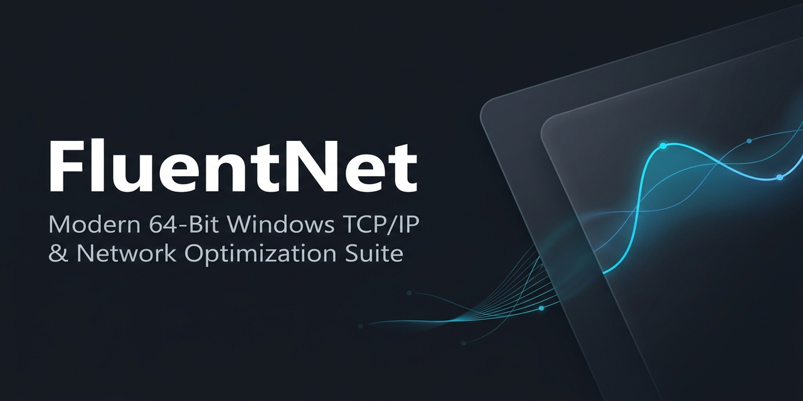

<p align="center">
  
</p>

<p align="center">
  <a href="https://dotnet.microsoft.com/"></a>
  <a href="https://learn.microsoft.com/windows/apps/winui/winui3/"></a>
  
  
  <a href="docs/ARCHITECTURE.md"></a>
</p>

# ⚡ FluentNet

**FluentNet** is a modern, open-source, strictly **64-bit** (`x64` / `arm64`) Windows 10 & Windows 11 TCP/IP, DNS, and network adapter optimization suite—engineered from scratch as a clean-room successor to SpeedGuide's classic **SG TCP Optimizer**.

---

## 🎯 Why FluentNet Over Legacy TCP Optimizer?

| Capability | Classic SG TCP Optimizer | FluentNet |
|---|---|---|
| **Architecture & Runtime** | 32-bit x86, legacy Win32/ICMP.dll | Strictly **64-bit** (`x64` / `arm64`), `.NET 10` NativeAOT + `.NET 4.8` portable edition |
| **OS & Stack Awareness** | WinXP/7 era static RWIN, `TCP Chimney`, `NetDMA`, Win9x `VxD\MSTCP`, IE `FeatureControl` | Modern Windows 10/11 stack: `CUBIC`, `CTCP`, `BBR2` (with Win11 24H2+ `loopbacklargemtu` guard), `TCP Fast Open`, `RSS`/`RSC`, `AFD`, per-NIC driver properties |
| **Execution Engine** | Slow per-setting `powershell.exe` / `netsh` spawns | Parallel **native `.NET` CIM/WMI (`ROOT\StandardCimv2`)** & **64-bit Registry** writes with zero PowerShell spawns |
| **Privilege Model** | Requires full admin elevation at launch | Runs **`asInvoker` (unelevated)** for scanning, diagnostics, DNS benchmarking, and script export; elevates **on-demand** only for Apply/Rollback |
| **Change Safety** | Blind registry/netsh writes | Transparent **Diff Preview** (`Current → Proposed`, `Windows Default`, exact CIM/Registry path, reboot flag), **mandatory JSON snapshots**, and **1-click rollback** |
| **Live Telemetry & DNS** | Static adapter text | **Live RX/TX throughput sparkline**, concurrent **DNS resolver benchmarking** with 1-click apply, **DNS/ARP cache flush**, and **DHCP renewal** |
| **Privacy** | Closed-source binary | 100% open source, zero telemetry, zero ads |

---

## ✨ Key Features

### 🖥️ Live Host Overview & Telemetry
- **Parallel Host-Scan Engine:** Probes OS build, CPU topology, active NICs, CIM TCP templates (`MSFT_NetTCPSetting`), global offloads (`MSFT_NetOffloadGlobalSetting`), and 64-bit Registry concurrently off the UI thread.
- **Real-Time NIC Sparkline:** Samples live RX/TX throughput every 2 seconds on the active adapter with a rolling 30-point sparkline and link speed/MTU status.
- **Smart Adapter Filtering:** Surfaces active physical Ethernet and Wi-Fi adapters cleanly on Overview while letting you toggle virtual/tunnel adapters when needed.
- **Global Search (`Ctrl+K`):** Instant filtering across all tuning parameters, driver properties, and network adapters from the title bar.

### ⚙️ Speed-Aware & Per-NIC Tuning
- **Adaptive Profiles:** Switch seamlessly between `Windows Default`, `Current`, `Recommended Optimal` (host-scanned), `Gaming / Low-Latency`, and `Custom`—or click **Recommended Settings** on Overview for a 1-click preset load.
- **Live Connection Speed Slider:** Drag from `10 Mbps` to `2500 Mbps` to auto-tune modern Windows TCP/IP parameters (`InitialRTO`, `MaxSynRetransmissions`, `Pacing`, `AFD FastSendDatagramThreshold`, `TcpTimedWaitDelay`, `NetworkThrottlingIndex`, `SystemResponsiveness`) for your bandwidth tier.
- **MTU & Offload Controls:** Native `MSFT_NetIPInterface.NlMtu` updates, `TCP Auto-Tuning`, `Scaling Heuristics`, `Congestion Control` (`CUBIC` / `CTCP` / `BBR2`), `ECN`, `Timestamps`, `TCP Fast Open`, `RSS`, and `RSC`.
- **Per-NIC Driver & Nagle Tuning:** Dynamically surfaces driver-exposed `NetAdapterAdvancedProperty` keys (`*InterruptModeration`, `*EEE`, `*FlowControl`, `*NumRssQueues`, `*JumboPacket`) alongside per-interface Nagle controls (`TcpAckFrequency`, `TCPNoDelay`, `TcpDelAckTicks`).
- **Save & Load Custom Profiles:** Export and reload reusable `.json` profiles locally under `%LocalApplicationData%\FluentNet\Profiles`.

### 🌐 DNS Switcher, Repair & Diagnostics
- **Concurrent DNS Benchmark & 1-Click Switcher:** Benchmarks curated public resolvers (Cloudflare, Google, Quad9, AdGuard, OpenDNS) concurrently over TCP/53 and applies your chosen preset—or the fastest measured resolver—directly via `MSFT_NetClientDnsServerAddress`.
- **1-Click Network Repair:** Native Win32 `dnsapi.dll` **DNS cache flush**, `iphlpapi.dll` **ARP table flush**, and **DHCP lease renewal**.
- **Async ICMP Diagnostics:** Non-blocking binary-search **Path MTU Discovery** (`DF` bit), concurrent **multi-target latency/jitter/loss sweeps** with `A+`–`F` connection grading, **traceroute**, and a **BDP / RWIN calculator**.

### 🛡️ Snapshots, Rollback & Auditability
- **Diff Review Dialog:** Every modification is staged and reviewed (`Current → Proposed`, `Windows Default`, exact CIM/Registry path, reboot indicator) before anything is written.
- **Snapshot Manager:** Automatically saves timestamped JSON backups before every apply; supports multi-select inspection, 1-click restore, and bulk deletion.
- **Standalone Script Export:** Export any staged change plan as auditable `.ps1` and `.reg` files to your Desktop.

---

## 🏗️ Architecture

FluentNet uses a **dual-head 64-bit architecture** sharing a single NativeAOT-ready core engine:

| Component | Target | Purpose |
|---|---|---|
| **`FluentNet.Core`** | `.NET 10` (`x64;arm64`) | Parallel Host Scanner, CIM/WMI & 64-bit Registry providers, DNS optimizer, BDP calculator, Diff engine, JSON snapshots, `.ps1`/`.reg` exporter, and `iphlpapi.dll` ICMP probes. |
| **`FluentNet.App`** | `.NET 10` **WinUI 3** (Unpackaged, NativeAOT) | Flagship Windows 11 Fluent UI (Mica, `NavigationView`, floating toast notifications, live sparkline, `ContentDialog`). |
| **`FluentNet.Classic`** | **`.NET 4.8` WPF** (`x64`, Zero-NuGet) | Lightweight, zero-dependency portable `.exe` for clean Windows 10/11, Server, or OOBE environments—compiling shared `.Core` `.cs` files directly. |
| **`FluentNet.Cli`** | `.NET 10` (`x64;arm64`) | Headless CLI & on-demand UAC-elevated worker for Apply and Rollback. |

📖 **Read the full technical specification in [`docs/ARCHITECTURE.md`](docs/ARCHITECTURE.md).**

---

## 🛠️ Building from Source

```powershell
# Run unit & regression tests
dotnet test src/FluentNet.Tests/FluentNet.Tests.csproj -c Release

# Build Classic Portable Edition (.NET 4.8 WPF, x64)
dotnet build src/FluentNet.Classic/FluentNet.Classic.csproj -c Release -p:Platform=x64

# Publish WinUI 3 Flagship (Unpackaged NativeAOT, x64)
dotnet publish src/FluentNet.App/FluentNet.App.csproj -c Release -p:Platform=x64

# Publish all 3 binaries locally to D:\Program\FluentNet
powershell -NoProfile -ExecutionPolicy Bypass -File tools/Publish-Local.ps1
```

---

## 🤝 Contributing & Governance

- Pull requests auto-trigger **CodeRabbit** AI reviews (`.coderabbit.yaml`) and **GitHub Actions CI** (`ci.yml`, `codeql.yml`).
- Use the provided [Bug Report](.github/ISSUE_TEMPLATE/bug_report.yml), [Feature Request](.github/ISSUE_TEMPLATE/feature_request.yml), and [Pull Request](.github/PULL_REQUEST_TEMPLATE.md) templates.
